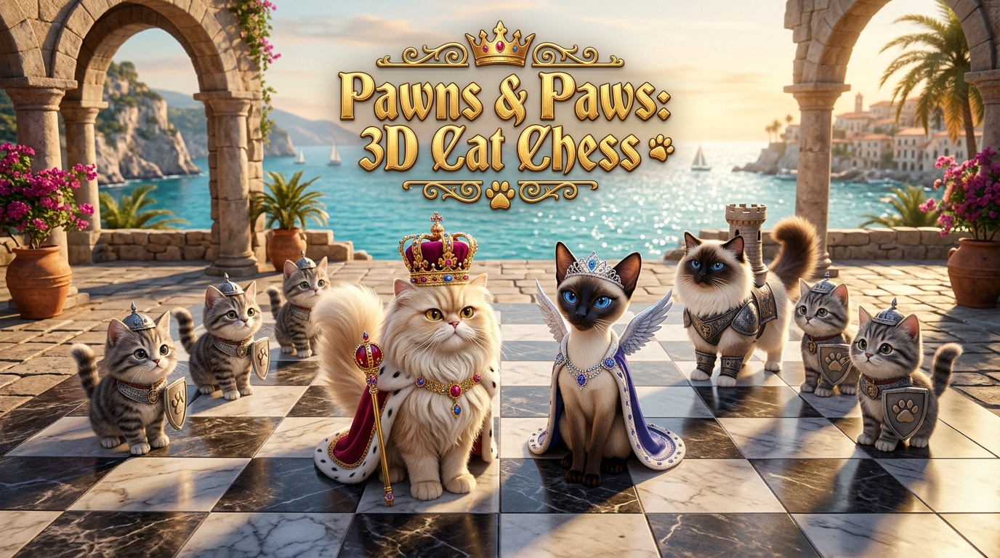
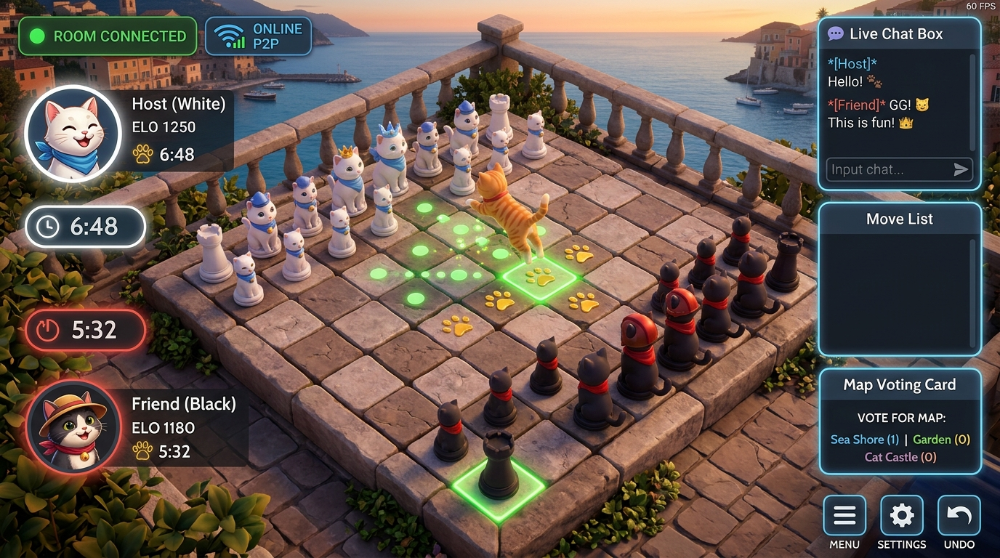
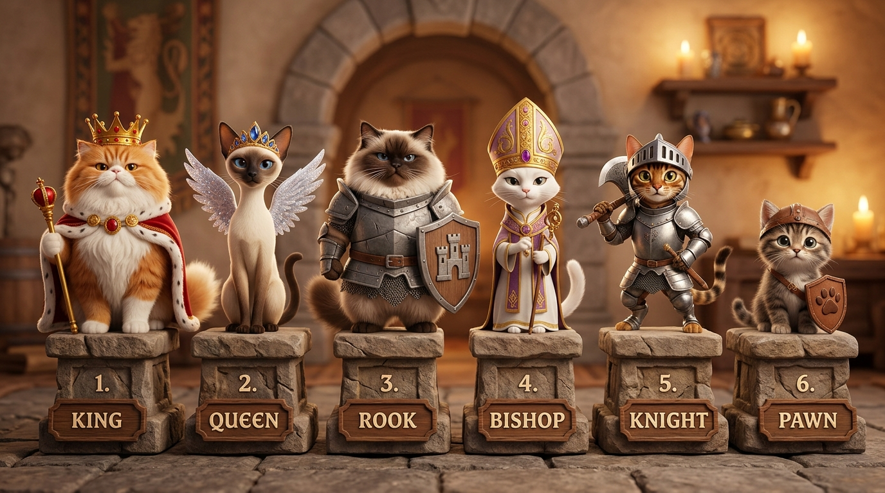

# 🐾 Pawns & Paws: 3D Cat Chess

<div align="center">



**A high-performance, fully playable 3D chess game where grandmaster strategy meets charming feline antics!**

[](https://void4ux.github.io/pawns-and-paws-3d-cat-chess/)
[-38bdf8?style=for-the-badge)](https://peerjs.com/)
[](https://threejs.org/)
[](LICENSE)

[**✨ Play Live Game**](https://void4ux.github.io/pawns-and-paws-3d-cat-chess/) • [**🌐 How to Play Multiplayer**](#-online-multiplayer-with-friends) • [**🐱 Cat Breeds Guide**](#-the-royal-feline-roster) • [**⚡ Zero-Lag Optimizations**](#-performance--zero-lag-engine)

</div>

---

## 🌟 Overview

**Pawns & Paws: 3D Cat Chess** turns every chess square into an interactive feline adventure. Built with **Three.js**, **Chess.js**, and **PeerJS**, it features full 3D procedural cat rigs with expressive feline behaviors (blinking, ear twitching, kneading paws, licking paws, yawning), an interactive Mediterranean coastal plaza, and **direct peer-to-peer online multiplayer** that runs straight in the browser with **zero server setup and zero lag**.

Whether you're playing against friend links across the globe, challenging the chess engine bots, or solving tactical puzzles, the game delivers an ultra-smooth, tactile 60 FPS tabletop experience.

---

## 🌐 Online Multiplayer With Friends

Play real-time chess with your friends anywhere in the world directly in your browser. No accounts or server hosting needed!

<div align="center">



</div>

### How to Play with a Friend:
1. **Host a Match**:
   - Open the game and click **Online Multiplayer**.
   - Click **➕ Create Room** to generate a unique room code (e.g. `PAWS-4821`).
   - Click **🔗 Copy Link** to copy your direct 1-click invite link:
     ```
     https://void4ux.github.io/pawns-and-paws-3d-cat-chess/?room=PAWS-4821
     ```
2. **Invite Your Friend**:
   - Send the link to your friend on Discord, WhatsApp, Telegram, or Twitter/X.
   - When your friend opens the link, the game **automatically connects them** as Black!
3. **Live Sync Features**:
   - **Instant Moves**: Board moves synchronize in milliseconds over WebRTC DataChannels.
   - **Live Arena Map Voting**: Both players vote on their favorite diorama theme before the match starts.
   - **In-Game Chat & Reactions**: Send cute cat messages and trigger floating 3D emoji reactions (`😹`, `🐟`, `🧶`, `🐾`, `👑`, `🔥`).
   - **Pass-and-Play Fallback**: Same-machine multi-tab testing via native `BroadcastChannel`.

---

## 🐱 The Royal Feline Roster

Every piece is a distinct, fully animated 3D cat breed with customized outfits, armor, and playstyles:

<div align="center">



</div>

| Piece | Breed & Role | Visual Description | Signature Style |
|:---:|:---|:---|:---|
| **♔ King** | **Royal Chonky Persian King** | Ultra-fluffy boss cat with a smug royal gaze, 5-point ruby & sapphire gold crown, and velvet coronation cape. | Dignified royal stride & heavy regal pounce. |
| **♕ Queen** | **Slender Siamese Crown Queen** | Tall, graceful Oriental Queen with piercing sapphire eyes, golden tiara, and radiant celestial wings. | Swift high-speed pounce & precision claw strike. |
| **♖ Rook** | **Ragdoll Guardian Rook** | Muscular seal-point Ragdoll cat clad in carved granite battle armor and protective gauntlets. | Unstoppable fortress charge. |
| **♗ Bishop** | **Mitre-Crowned Plaza Bishop** | Sleek pure-white cat wearing a liturgical gold-embroidered mitre hat and ceremonial clergy stole. | Silent diagonal glide & sacred paw sweep. |
| **♘ Knight** | **Armored Bengal Knight** | Dynamic Bengal warrior wearing a forged knight visor helmet and battle axe. | High-arching agile leap with battle cry. |
| **♙ Pawn** | **Playful Tabby Kitten** | Energetic little striped kitten bearing an embossed leather paw shield and recruit cap. | Quick playful pounce & paw swat. |

---

## ⚡ Performance & Zero-Lag Engine

The engine has been re-architected from the ground up for butter-smooth 60 FPS gameplay on phones, laptops, and desktop computers:

1. **Intelligent Piece Pooling (Zero Memory Leaks)**:
   - Old versions re-instantiated all 1,200 meshes and 480 materials on every single move, causing garbage collection spikes.
   - The new engine **pools and reconciles rigs**: pieces smoothly glide to their new squares with **zero memory allocations** per move.
2. **GPU Transform Waves**:
   - Replaced a 1,369-vertex per-frame CPU vertex math loop on the water mesh with hardware-accelerated transform bobbing, saving significant CPU cycles.
3. **Optimized Shadow Passes**:
   - Upgraded to `THREE.PCFShadowMap` with selective shadow casting on primary body volumes rather than micro-elements, cutting shadow passes by ~80%.
4. **Snappy & Tactile Moves**:
   - Move animation durations refined to a responsive **220ms–380ms** leap.
   - Stable camera perspective ensures the board remains clear and easy to read during fast tactical games.
5. **Adaptive Pixel Ratio**:
   - Clamped device pixel ratio at `1.5x` on high-DPI Retina screens to eliminate GPU fillrate bottlenecks while preserving razor-sharp visuals.

---

## 🎮 Controls & Hotkeys

| Action | Control / Hotkey | Description |
|:---|:---:|:---|
| **Select / Move** | `Left Click` / `Tap` | Select cat piece and tap highlighted green circle to execute move |
| **Toggle Camera View** | `V` | Switch between 3D Diorama and Top-Down Overhead View |
| **Flip Board** | `F` | Flip board 180° to view from Black's perspective |
| **Reset View** | `C` | Re-center and snap camera back to default angle |
| **Engine Hint** | `H` | Request Stockfish-style evaluation hint from Web Worker bot |
| **Undo / Redo** | `Z` / `Y` | Take back or replay previous moves in practice mode |
| **Mute Audio** | `M` | Toggle atmospheric seaside chimes and cat sound effects |

---

## 🛠️ Tech Stack

- **Graphics**: [Three.js r128](https://threejs.org/) (WebGL 3D Rendering, PCF Shadow Mapping, PBR Materials)
- **Chess Engine**: [Chess.js](https://github.com/jhlywa/chess.js) (Move validation, FEN/PGN parser, legal move generation)
- **Multiplayer**: [PeerJS](https://peerjs.com/) (WebRTC DataChannels, P2P peer routing, zero backend required)
- **Styling**: [TailwindCSS](https://tailwindcss.com/) & Modern CSS Glassmorphism
- **Audio**: Custom Web Audio API Synthesizer (procedural feline purrs, meows, and seaside ambience)

---

## 🚀 Running Locally

No npm build step is required! You can run the game with any static HTTP server:

```bash
# Clone the repository
git clone https://github.com/void4ux/pawns-and-paws-3d-cat-chess.git
cd pawns-and-paws-3d-cat-chess

# Start a local static server (Python 3)
python3 -m http.server 8080

# Open in your browser
open http://localhost:8080
```

---

## 🌐 Deploying to GitHub Pages

1. Go to your repository **Settings** on GitHub.
2. In the left sidebar, click **Pages**.
3. Under **Build and deployment** > **Branch**, select `main` and folder `/ (root)`.
4. Click **Save**. Your game will be live at:
   `https://<your-username>.github.io/<repo-name>/`

---

## 📄 License

Distributed under the **MIT License**. See `LICENSE` for more information.

<div align="center">
  <sub>Crafted with 🐾 by <a href="https://github.com/void4ux">void4ux</a></sub>
</div>
